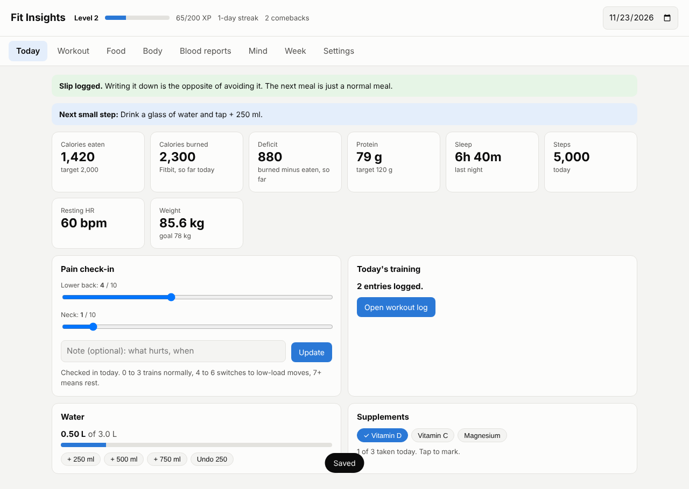

# Fit Insights

A personal, injury-aware health app. It pulls Fitbit data from the Google Health API, logs workouts, food, water and supplements, and uses an AI coach that is not allowed to recommend anything the safety rules have ruled out.



**Why it exists.** Fitness apps assume a healthy spine. After a lumbar disc injury, a generic plan is a risk: one loaded deadlift on a bad day can cost weeks. Existing trackers also show data in separate places (Fitbit for sleep, a notes app for lifts, a PDF for blood work) and punish a missed day with a broken streak, which is exactly when people quit. This app is built around those two problems: train without re-injury, and come back after a slip.

## What's in it

| Tab | What it does |
|---|---|
| Today | Calories in and out, deficit, sleep, steps, pain check-in, water, supplements, one "next small step" |
| Workout | A 4-day split, 149 exercises with equipment, weight, reps and sets, last-time numbers, back-safe picks, AI plan for the day |
| Food | Voice note or typed text → calories and protein (English or Hinglish), manual entry, water, supplements |
| Body | Weight trend against goal, calories eaten vs burned, 7-day deficit and expected fat loss, cardio load, Fitbit charts |
| Blood reports | Upload a PDF or photo → out-of-range values, plain-English meaning, whether to see a doctor |
| Mind | Mood, "I slipped" button, coach chat, bounce-back rate |
| Week | 7-day table and an AI weekly review |

## How the back-safety works

Two layers. First, fixed rules: every exercise has a spine-load rating (low, medium, high) and a neck flag. High-load and neck-loading moves are never offered. At back pain 4 to 6 only low-load moves remain. At 7+ it is a rest day with walking and mobility only. Second, the AI coach can only choose from what the rules allow, and anything else it suggests is thrown away. The AI personalises. It cannot override safety.

## How the gamification works

Streak apps punish a missed day, which is exactly when you tend to stop. This one pays for returning: logging a slip earns XP, and logging anything the day after a slip or a gap earns a 50 XP comeback bonus. The headline number is **bounce-back rate**: the share of slips followed by a logged day.

## How it's built

- One Python file (`api/index.py`, built from `src/backend.py` and `src/frontend.html` by `src/build.py`). No web framework, no front-end libraries. Charts are hand-written SVG.
- Online it runs as a single Vercel function and stores data in Postgres (Neon). On a laptop the same file runs with `python3 api/index.py` and stores data in a local SQLite file.
- Fitbit data comes from the Google Health API v4 over OAuth. The AI calls go to Gemini.
- Access is behind a passcode (PBKDF2 hash, lockout after 5 wrong tries). The repository holds code only: keys, tokens and logs live in the database.

## Put it online with Vercel (about 20 minutes, once)

1. Go to **vercel.com** → **Sign Up** → **Continue with GitHub** (the free Hobby plan).
2. **Add New… → Project** → find this repository → **Import** → leave every setting as it is → **Deploy**.
3. Open the address Vercel gives you. It shows "Almost there: connect a database" with the steps, which are:
   - In the project, open the **Storage** tab → **Create Database** → **Neon** → keep the suggested region and the **Free** plan → **Create** → connect it to this project.
   - **Deployments** tab → **…** on the top row → **Redeploy**.
4. Reload the address. It asks you to **create a passcode**. Do it straight away: until you do, anyone who opens the address could set one.
5. In the app, open **Settings**:
   - *Fitbit*: copy the line that ends in `/callback`. In Google Cloud → Clients → your client → *Authorized redirect URIs* → **+ Add URI** → paste → **Save**. Back in the app, paste the Client ID and Client secret → Save → **Sign in with Google**.
   - *AI coach*: get a key at `aistudio.google.com/apikey` → paste → Save key.
   - *About you*: age, height, goal weight, calorie target.
6. On the iPhone: open the address in Safari → enter the passcode → Share → **Add to Home Screen**. Open the new icon and enter the passcode once more (the icon keeps its own login).

Every push to this repository redeploys the app. Data is not touched.

**Things to know**

- While the Google Cloud project is in "Testing", Google signs the app out of Fitbit every 7 days. Settings → Sign in with Google again.
- Vercel caps uploads at about 3 MB. Photos of blood reports are shrunk automatically. A PDF over 3 MB is refused, so photograph the pages instead. Voice notes stop at about 90 seconds.
- The free database sleeps when idle, so the first tap after a break can take a second or two.

## Run it on your own computer instead

```
python3 api/index.py
```

Then open `http://localhost:8080`. Nothing to install. In Google Cloud add `http://localhost:8080/callback` as a redirect URI. Data stays in `fit.db` next to the file.

## Honest limits

- Tested end to end against simulated Google and Gemini responses and a local Postgres database, with a phone-sized browser. Sleep and steps follow documented formats. Calories burned, zone minutes, resting HR, HRV and SpO2 use best-effort parsing because Google doesn't document those fields.
- Workouts are logged by hand (fast, with last-time numbers prefilled). The app does not auto-detect gym sets from the Fitbit.
- Calorie estimates from a voice note are rough, about ±20%.
- Spine-load ratings are general gym guidance, not medical advice. A physio should look over the list.
- Blood report analysis can misread a scan and never diagnoses.
- The mind coach is not therapy.
- Privacy: food notes, blood reports and coach chats go to Google's Gemini. On the free tier Google may use that content to improve its products. Everything else sits in the database behind the passcode.
